 

 

---

## 👨‍💻 About Me

I'm a **Computer Science and Business Systems (CSBS) student at NMIT** exploring the intersection of **Data Science, Machine Learning, Generative AI, and Agentic AI**, aiming to become a **Forward Deployed Engineer**.

- 🧠 I like understanding the *why* behind models—not just calling APIs.
- 🛠️ I build practical projects that connect ML with usable software.
- 🌱 Currently sharpening ML/DS, GenAI, backend engineering, and DSA.
- 🎯 Long-term direction: research, open source, and impactful AI engineering.

> **My approach:** Learn deeply → build honestly → measure results → improve continuously.

## ⚡ Tech I Work With

**LANGUAGES** 

**AI / DATA** 

&nbsp; 
&nbsp; 
 

&nbsp; 
&nbsp; 
&nbsp; 
&nbsp; 

**DEVELOPMENT & TOOLS** 

## 🚀 Selected Projects

<table>
<tr>
<td width="50%" valign="top">

### 🔎 ResearchPilot
Eval-driven multi-agent research assistant. Every claim is cited to a source chunk, and unanswerable questions are refused.

**Focus:** LangChain · LangGraph · LangSmith · Hybrid RAG · Agent Evals

<a href="https://github.com/bhzcode1/researchpilot">↗ View repository</a>

</td>
<td width="50%" valign="top">

### 🧾 Complaint Extraction LLM
A small fine-tuned LLM that turns free-text consumer complaints into structured JSON, distilled from a larger teacher model and monitored for drift.

**Focus:** LLM Fine-tuning · Distillation · Drift Monitoring

<a href="https://github.com/bhzcode1/customer-s-complaint">↗ View repository</a>

</td>
</tr>
<tr>
<td colspan="2" valign="top">

### 🎬 YouTube Shorts Automation
Turns a topic into YouTube Shorts with no human step: Claude picks the best live-stream moments, clips are cut to 9:16 with captions, reviewed by Claude, then uploaded on a daily schedule.

**Focus:** Agentic Automation · Claude · ffmpeg · Scheduling

<a href="https://github.com/bhzcode1/youtube_automate">↗ View repository</a>

</td>
</tr>
</table>

<a href="https://github.com/bhzcode1?tab=repositories"><b>More projects →</b></a>

## 📈 GitHub Activity

 

## 🧭 On My Radar

- [x] Build and publish ML projects
- [x] Explore AI application development
- [ ] Keep progressing through a structured DSA roadmap
- [ ] Contribute consistently to open source
- [ ] Grow into research-ready Data Science / ML engineering

## 🤝 Find Me

---

  <i>Curiosity in. Projects out. Repeat.</i>
    
  

