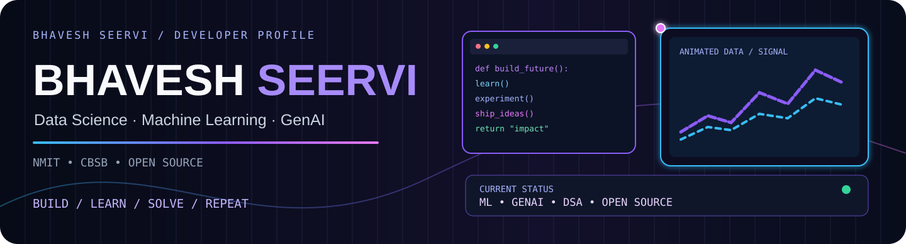

 

 

---

## 👨‍💻 About Me

I'm a **Computer Science and Business Systems (CSBS) student at NMIT** exploring the intersection of **Data Science, Machine Learning, and Generative AI**.

- 🧠 I like understanding the *why* behind models—not just calling APIs.
- 🛠️ I build practical projects that connect ML with usable software.
- 🌱 Currently sharpening ML/DS, GenAI, backend engineering, and DSA.
- 🎯 Long-term direction: research, open source, and impactful AI engineering.

> **My approach:** Learn deeply → build honestly → measure results → improve continuously.

## ⚡ Tech I Work With

**LANGUAGES** 

**AI / DATA** 

&nbsp; 
&nbsp; 

**DEVELOPMENT & TOOLS** 

## 🚀 Selected Projects

<table>
<tr>
<td width="50%" valign="top">

### 🛡️ Fraud Detection ML
Machine-learning project focused on identifying fraudulent transactions from data.

**Focus:** Classification · Feature Engineering · Model Evaluation

<a href="https://github.com/bhzcode1/fraud-detection-ml">↗ View repository</a>

</td>
<td width="50%" valign="top">

### 📊 Insurance Prediction
Predictive modeling on insurance data, exploring how features influence outcomes.

**Focus:** Data Analysis · Regression · ML Pipeline

<a href="https://github.com/bhzcode1/Insurance-prediction">↗ View repository</a>

</td>
</tr>
<tr>
<td width="50%" valign="top">

### 🔐 AutoQrypt · PQC-02
Post-quantum secure firmware-update verification for automotive ECUs.

**Focus:** Embedded Security · ESP32 · Post-Quantum Signatures

<a href="https://github.com/imnottaken/AutoQrypt">↗ View repository</a>

</td>
<td width="50%" valign="top">

### 🧾 Customer Complaint Analysis
Exploring customer complaint data to uncover patterns and useful insights.

**Focus:** Python · Data Analysis · Visualization

<a href="https://github.com/bhzcode1/customer-s-complaint">↗ View repository</a>

</td>
</tr>
</table>

<a href="https://github.com/bhzcode1?tab=repositories"><b>More projects →</b></a>

## 📈 GitHub Activity

 

## 🧭 On My Radar

- [x] Build and publish ML projects
- [x] Explore AI application development
- [ ] Keep progressing through a structured DSA roadmap
- [ ] Contribute consistently to open source
- [ ] Grow into research-ready Data Science / ML engineering

## 🤝 Find Me

---

  <i>Curiosity in. Projects out. Repeat.</i>
    
  

